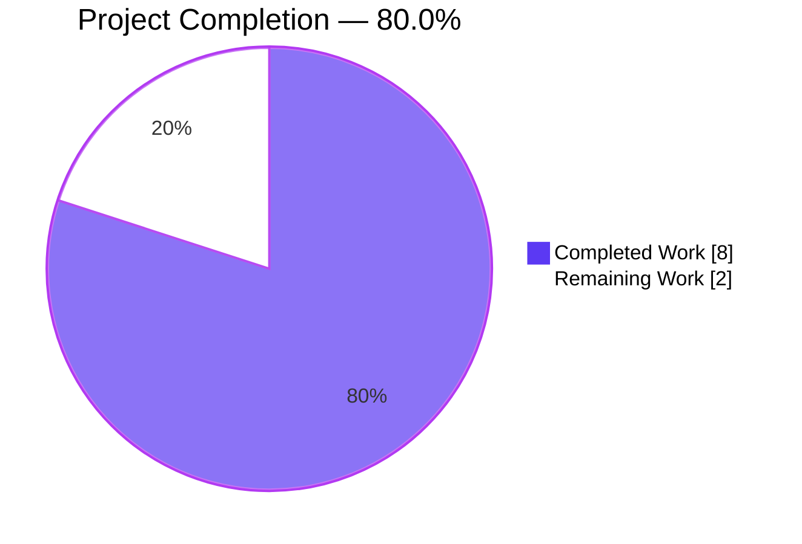
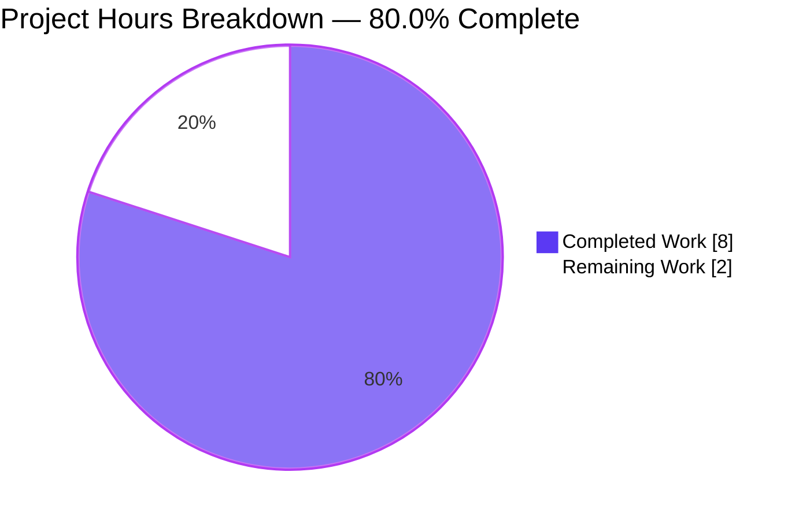
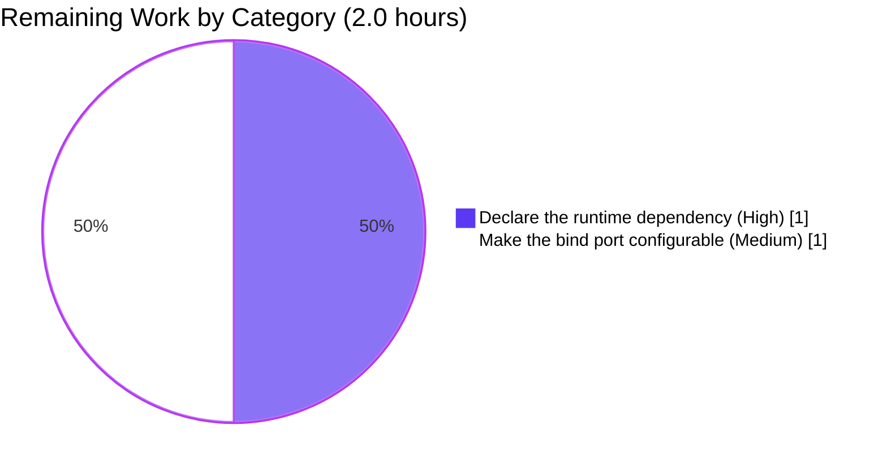

# 1. Executive Summary

## 1.1 Project Overview

0211_2Files is a two-file Node.js artifact: `server (1).js` answers every HTTP request on port 3000 with the plain-text body `Hello, World!`, and `README.md` names the project and the single command that runs it. This work documented both — one JSDoc summary line above the request handler and the README rewritten in place — leaving the handler byte-for-byte unchanged, adding no dependency and creating no other file.

## 1.2 Completion Status

10.0 hours are in scope: **8.0 completed**, **2.0 remaining** — **80.0% complete**. All 13 requirements are delivered and verified; the remaining 2.0 hours are production enablement, not unfinished documentation.

Completion = completed hours ÷ (completed + remaining) × 100 = 8.0 ÷ 10.0 × 100 = **80.0%**



| Metric | Hours / Value |
|---|---|
| Total Hours | 10.0 |
| Completed Hours (AI + Manual) | 8.0 |
| Remaining Hours | 2.0 |
| Completion | 80.0% |

## 1.3 Key Accomplishments

- ✅ One JSDoc summary line above the request handler, byte-exact, as the file's only change.
- ✅ README rewritten in place with the project name, a run heading and the quoted command.
- ✅ Every method and path answers 200 with the 14-byte body `Hello, World!\n`.
- ✅ The published command starts the server, binds port 3000 and serves.
- ✅ Stopping releases the port; three restart cycles rebind and serve.
- ✅ 250 burst requests and 25 concurrent browser requests, all answered identically.
- ✅ A second instance fails with `EADDRINUSE`; with the dependency unresolvable the command exits 1 naming `server (1).js:1:11`.
- ✅ Change inertness: the pre-change revision serves the identical body.

## 1.4 Critical Unresolved Issues

**Open items: 2 of the 15 scoped work items.** All 13 requirements are delivered and verified; both open items are path-to-production. Six characteristics of the pre-existing handler were accepted as caveats inside the request's scope boundary and carry no scheduled work.

| Issue | Impact | Owner | ETA |
|---|---|---|---|
| Path-to-production (1 of 2): the runtime dependency is undeclared, so the published run command needs a resolvable `lodash` (`README.md:5`, `server (1).js:1`) | The documented entry point exits 1 with `Cannot find module 'lodash'` at `server (1).js:1:11` on any machine without one | Platform/Release engineer | Next release |
| Path-to-production (2 of 2): the bind port is hardcoded to 3000 and host-global (`server (1).js:6`) | A second instance, CI job or second deployment exits 1 with `EADDRINUSE` at `server (1).js:6:4` | Platform/Release engineer | Next release |
| Accepted caveat (1 of 6): the listener binds the unspecified address on all interfaces while the banner and README advertise `127.0.0.1` (`server (1).js:6`) | The handler is reachable on every interface of the host, which is wider than the documentation implies | Delivery owner | Decision at promotion |
| Accepted caveat (2 of 6): responses carry no `Content-Type` (`server (1).js:5`) | Clients must sniff the 14-byte body and an intermediary may guess a different type | Delivery owner | Decision at promotion |
| Accepted caveat (3 of 6): every path — including unknown paths and `/favicon.ico` — returns 200 with the same body; there is no 404 or error handling (`server (1).js:4`) | Unknown paths look like successes to clients, crawlers and monitoring | Delivery owner | Decision at promotion |
| Accepted caveat (4 of 6): no request timeouts, size limits or graceful shutdown (`server (1).js:4-6`) | An incomplete request can hold a socket with no response, and a termination signal does not drain in-flight work | Delivery owner | Decision at promotion |
| Accepted caveat (5 of 6): no logging or observability beyond the startup banner | Malformed or abusive traffic is answered with parser-level 400/431 responses and nothing is written to the log | Delivery owner | Decision at promotion |
| Accepted caveat (6 of 6): the one-line summary quotes the body without its trailing newline and calls it plain text while no content type is sent (`server (1).js:3` vs `:5`) | A maintainer reading only the comment would not learn the response's exact wire form; the comment is a second copy of the response value | Delivery owner | Keep in step with the response body |

## 1.5 Access Issues

No access issues identified. No credential, API key, third-party account or environment variable is needed to build, run or verify this repository.

## 1.6 Recommended Next Steps

1. **[High]** Declare the runtime dependency so the published command runs wherever the repository is read (1.0 h) — or delete the unused `require` on `server (1).js:1`.
2. **[Medium]** Make the bind port configurable, default 3000, and verify a restart and a second instance (1.0 h).
3. **[Medium]** Decide the bind address: bind loopback explicitly if the artifact stays local.
4. **[Low]** If the handler is promoted, send a `Content-Type` and define the answer for unknown paths.
5. **[Low]** Add a regression check asserting the served body and the boot of the published command.

# 2. Project Hours Breakdown

## 2.1 Completed Work Detail

| Component | Hours | Scope Description |
|---|---|---|
| `server (1).js` — one-line JSDoc summary above the request handler | 0.5 | The requested sentence placed alone on the line immediately above the statement that installs the handler, with no tags, no example and no other change to the file; the five pre-existing lines are byte-identical to the revision before the change. |
| `README.md` — five-line rewrite in place | 1.0 | Project name retained as the level-1 heading, a run heading added, and the run command named and quoted as it exists on disk (`node "server (1).js"`); the file is 5 lines / 48 bytes, inside the 15-line limit and with no extra section, badge or link. |
| Install-item decision and its recorded consequence | 0.5 | The install item settled as the request's "(if any)" case: no install line is published and no package is named, so the repository's only command is documented without publishing a dependency instruction; the consequence for a machine without a resolvable `lodash` is carried openly rather than hidden behind a misleading step. |
| Two-file scope discipline | 0.5 | The change held to exactly the two named files: no third file, no manifest, lockfile, dependency, test file, 404 or error handler, environment configuration or hardening, and nothing renamed. |
| Static verification of the delivered contents | 2.0 | Syntax gate, byte-exact comparison of both delivered contents against the requested contents, diff-shape checks (+1/−0 for the server file, +5/−1 for the README), tree census, and each documented claim falsified against the code it describes. |
| Runtime and browser verification of the delivered artifact | 3.5 | 103 executed checks: method × path matrix, header set, exact response bytes, HEAD semantics, HTTP/1.0, the runtime parser's error surface, concurrency bursts, bind-conflict behaviour, stop/restart lifecycle, startup with the dependency unresolvable, change inertness against the pre-change revision, and browser rendering of every path. |
| **Total** | **8.0** | Matches Completed Hours in Section 1.2. |

## 2.2 Remaining Work Detail

| Category | Hours | Priority |
|---|---|---|
| Declare the runtime dependency so the published run command works wherever the repository is read — add a manifest or an equivalent declaration for the package `server (1).js:1` requires and verify the command on an environment without one (path-to-production; ties to `README.md:5`, `server (1).js:1`) | 1.0 | High |
| Make the bind port configurable with 3000 as the default and verify a restart and a second instance (path-to-production; ties to `server (1).js:6`) | 1.0 | Medium |
| **Total** | **2.0** | Matches Remaining Hours in Section 1.2 and the Remaining Work value in Section 7. |

Both categories are path-to-production enablement rather than unfinished requirements: every requirement the work was scoped against is delivered and verified. Each traces to a recorded consequence of the request's own scope boundary — the published command's dependence on a package the repository does not declare, and the port that is fixed in source and global to the host — which is why neither could be closed inside the change itself.

## 2.3 Human Task List

| ID | Priority | Task | Hours |
|---|---|---|---|
| T1 | High | Declare the runtime dependency: add a manifest naming the required package (or an equivalent declaration) and verify `node "server (1).js"` boots and serves on an environment without a global copy. Equivalent alternative at the same cost: delete the unused `require('lodash')` on `server (1).js:1`, whose binding `_` is never dereferenced, removing the dependency instead of declaring it. | 1.0 |
| T2 | Medium | Make the bind port configurable (environment override, default 3000) and verify a clean restart and a second instance, closing the `EADDRINUSE` failure at `server (1).js:6:4`. | 1.0 |
| | | **Scheduled total** | **2.0** |

**Unscheduled decisions** (recorded so the owner can act; no hours are scheduled and none is added to Section 2.2):

| ID | Priority | Decision |
|---|---|---|
| D1 | Medium | Choose the bind address: the listener currently binds the unspecified address and is reachable on every interface although the banner and the README advertise `127.0.0.1`; bind loopback explicitly if the artifact should stay local (≈0.5 h if taken). |
| D2 | Low | Confirm whether the handler is promoted beyond its documented smoke purpose; if so, send a `Content-Type` and define the response for unknown paths and failures. |
| D3 | Low | Decide on request timeouts, size limits, graceful shutdown and request logging for any promoted use. |
| D4 | Low | Introduce a regression check asserting the served body and the boot of the published command, so the contract cannot break silently. |

# 3. Test Results

Every figure below comes from checks executed against the delivered revision in this repository — 103 checks run, 103 passed, 0 failed. No test framework, runner or coverage instrument is installed in the repository (there is no manifest to declare one), so the checks were driven directly against the files and the running server.

| Area / Category | Framework | Tests | Passed | Failed | Coverage | What This Proves |
|---|---|---|---|---|---|---|
| Static gate and deliverable fidelity | Node.js `--check`, byte and diff comparison | 4 | 4 | 0 | n/a — no instrumentation exists | Both files parse, the delivered contents are byte-identical to the requested ones, the server file changed by exactly one inserted line, and the tracked tree is exactly the two named files. |
| HTTP request/response contract | curl against the running server | 41 | 41 | 0 | n/a — no instrumentation exists | Every method and path — 7 methods × 5 paths, plus HEAD and an HTTP/1.0 client — is answered `200` with exactly 14 bytes, `Hello, World!\n`, `Content-Length: 14` and the same four headers. |
| Runtime error surface | Raw sockets and curl | 3 | 3 | 0 | n/a — no instrumentation exists | An unknown method and a malformed request line get `400` and an oversized request target gets `431`, with the process surviving and nothing internal disclosed. |
| Concurrency and socket robustness | 250 requests across two bursts (`-P 10`, `-P 50`) | 3 | 3 | 0 | n/a — no instrumentation exists | Every concurrent request is answered identically with a 14-byte body, with no lost response and no output on the error stream. |
| Process lifecycle, restart and bind conflict | Shell, port probes and pid ownership checks | 10 | 10 | 0 | n/a — no instrumentation exists | Starting binds port 3000 and serves; stopping releases the port; three restart cycles rebind and serve; a second instance exits 1 with an explicit `EADDRINUSE` on `server (1).js:6:4` while the first keeps serving. |
| Startup and dependency resolution | Masked module-path run of the published command | 4 | 4 | 0 | n/a — no instrumentation exists | Where the required dependency does not resolve, the command exits 1 with `Cannot find module 'lodash'` naming `server (1).js:1:11`, writes nothing to standard output and binds nothing — never a silent failure. |
| Change inertness | Diff plus a live A/B run against the pre-change revision | 1 | 1 | 0 | n/a — no instrumentation exists | The change is behaviourally inert: the file minus the added line reproduces the earlier revision byte for byte, and that revision serves the identical body. |
| Browser-rendered page and in-page request matrix | Headless Chrome: 4 navigations and 33 fetch requests | 37 | 37 | 0 | n/a — no instrumentation exists | The root page, an unknown path, `/favicon.ico` and a query-string payload all render as one plain-text line with zero console messages, and 33 in-page requests — including a keep-alive sequence and 25 concurrent — all returned `200` with the constant 14-byte body. |
| **Total** | | **103** | **103** | **0** | | |

**Not Covered** — capabilities that are delivered but that no test exercises:

- **No automated regression test exists.** The 103 checks above were executed by hand against the running server and the files on disk, so nothing re-runs them when the response body, the port binding or the README's command changes. The repository contains no test file and no runner.
- **No coverage measurement exists.** No instrumentation is installed, so no coverage figure can be given for either file; the checks above assert behaviour and content, not statement coverage.
- **Sustained load and soak behaviour are unmeasured.** Bursts of 250 requests and 25 concurrent in-page requests were answered identically, but no long-running or memory-growth test was run.
- **Only one runtime was exercised.** Every check ran on this host's Node.js v22.23.4; no other Node version or operating system was tested.
- **No graceful-shutdown path exists to test.** Stopping the process was verified to release port 3000, but there is no draining behaviour in the artifact, so none could be asserted.
- **Only two clients were exercised.** curl and one browser were used; other HTTP clients, browsers, HTTPS and HTTP/2 were not exercised, and the server serves plaintext HTTP/1.1 only.
- **No authenticated flow exists.** The handler dereferences no request data and requires no credential, so there is no login, token or authorization path to test.

# 4. Runtime Validation & UI Verification

The artifact was started with its published command and driven from the outside — over TCP, from a shell, and from a real browser. Each line below is a flow that was exercised and what was observed.

- ✅ **Startup from the published command** — `node "server (1).js"` prints `Server running at http://127.0.0.1:3000/`, binds port 3000 as a dual-stack listener, and writes nothing to the error stream.
- ✅ **Root page in a real browser** — `GET /` renders the single plain-text line `Hello, World!`; four navigations produced 13 requests, all answered 200, with zero console messages of any type.
- ✅ **Every method and path** — GET, POST, PUT, PATCH, DELETE, OPTIONS, TRACE and HEAD, against the root path, a deep path, a query string, an unknown path and `/favicon.ico`: 200 with the constant 14-byte body in every case.
- ✅ **Request bodies and query strings ignored** — a POST with a body and requests with complex query strings are answered byte-identically to a bare GET; the handler reads nothing from the request.
- ✅ **Unknown paths and `/favicon.ico`** — answered 200 with the same constant body and no error page, which is this handler's documented catch-all behaviour rather than a fault.
- ⚠ **Hostile input delivered in the query string** — an XSS payload reached the server and was neither reflected, executed nor logged; the client-side instrumentation recorded no dialog and no injected node. The handler's inertness is what protects it: it reads no request data.
- ⚠ **Startup where the required dependency does not resolve** — the published command exits 1 with `Cannot find module 'lodash'` naming `server (1).js:1:11`, writes nothing to standard output and binds nothing. The failure is clean and diagnostic, but the entry point depends on the environment supplying the package.
- ✅ **Concurrency** — 250 requests across two bursts and 25 concurrent in-page requests were all answered with the constant body, with no error output and no lost response.
- ✅ **Stop and restart** — stopping the process releases port 3000 immediately (probes confirm connection refused); three restart cycles rebound the port and served again.
- ⚠ **Second instance on the same port** — exits 1 with `listen EADDRINUSE: address already in use :::3000` at `server (1).js:6:4`, leaving the first instance serving; the port is global to the host and not configurable in the artifact.

**Integrations.** The project has none: it makes no outbound call, opens no database, cache or queue connection, and requires no external service, credential or API key. There is therefore no integration to exercise, and no integration was left unexercised.

**Never exercised at runtime.** HTTPS or HTTP/2 (the server is plaintext HTTP/1.1 only); any authenticated, authorized or session-based flow (no such surface exists — the handler reads no request data); graceful shutdown and in-flight request draining (no such path exists in the artifact); sustained or soak-level load beyond the bursts measured; any Node.js runtime version or operating system other than this host's v22.23.4; any client other than curl and one browser; and any behaviour under a declared `Content-Type`, since the response sends none and clients must sniff the body.

# 5. Compliance & Quality Review

## 5.1 Compliance Matrix

| # | Deliverable / Quality Dimension | Status | Progress | Evidence |
|---|---|---|---|---|
| 1 | Delivered content matches the requested content | ✅ Pass | Complete | `server (1).js:3` and `README.md:1-5` are byte-identical to the requested contents (89 bytes and 48 bytes). |
| 2 | Syntax and startup viability | ✅ Pass | Complete | `node --check "server (1).js"` exits 0; the published command boots, binds port 3000 and serves. |
| 3 | Smallest-diff discipline | ✅ Pass | Complete | `server (1).js` +1/−0 with the five pre-existing lines byte-identical; `README.md` rewritten in place, +5/−1. |
| 4 | Scope boundary held | ✅ Pass | Complete | Change set is exactly `README.md` and `server (1).js`; 0 files created, 0 deleted, nothing renamed; no `server.js`. |
| 5 | No dependency, manifest or lockfile added | ✅ Pass | Complete | No `package.json`, lockfile, `node_modules`, `.gitignore` or `.nvmrc` anywhere in the tree. |
| 6 | No documentation toolchain, diagram, link or reference artifact | ✅ Pass | Complete | No build configuration, no diagram, no badge, image or link; nothing else in the tree references either file. |
| 7 | No test file, error handler, environment configuration or hardening | ✅ Pass | Complete | No test or runner; no `404`, error handler or `process.env`; the request's prohibited additions are all absent. |
| 8 | Documentation accuracy | ✅ Pass | Complete | Every claim in both files falsified against the code: the project name is the retained heading, the command names the on-disk file byte for byte, and the comment's two claims hold for every path and method exercised. |
| 9 | Comment quality | ✅ Pass | Complete | Exactly one comment, alone on its line directly above the handler, no tags, no example, no placeholder and no change narration. |
| 10 | Runtime behaviour matches the documented description | ✅ Pass | Complete | Every method and path returns the constant 14-byte body; verified over 103 checks including browser-level requests. |
| 11 | Static security review | ✅ Pass | Complete | No secret, credential or long literal in either file; no input path, no dynamic evaluation, no shell or file access, no state — the handler dereferences nothing from the request. |
| 12 | Change inertness | ✅ Pass | Complete | The pre-change revision and the delivered revision produce identical status lines, header sets and bodies. |

## 5.2 AAP & Rule Divergences and Gaps

No requirement was implemented differently from the way the specification set it, none was skipped or deferred, and no user-specified rule exists that the delivered code fails to follow (the rule set is empty, so no rule could be violated). Every entry below is a gap or an accepted absence produced by the request's own scope boundary, and each is stated with the reason it stands.

| What the AAP/Rule Required | What Was Delivered Instead | Why It Diverged | Impact | Remediation |
|---|---|---|---|---|
| The README states the project name and the run command, with the install item settled as the request's "(if any)" case, and no dependency, manifest or lockfile added | `README.md:5` publishes `node "server (1).js"` and names no package, while `server (1).js:1` requires `lodash`, which the repository does not declare | The request's own prohibitions — smallest possible diff, only the two named files, no manifest, lockfile or dependency — left no way to declare it; the specification recorded the consequence instead of hiding it behind a step that adds a dependency | On any machine where `lodash` does not resolve, the documented entry point exits 1 with `Cannot find module 'lodash'` at `server (1).js:1:11` and binds nothing | Declare the runtime dependency (1.0 h, Task T1). The required binding `_` is never dereferenced, so deleting line 1 is an equal-cost alternative. Both sit outside this change's boundary |
| No source change beyond the one comment; no configuration and no hardening | `server (1).js:6` binds 3000 with no override path | Configuration and any change to the pre-existing binding were forbidden by the request | The documented command exits 1 with `EADDRINUSE` at `server (1).js:6:4` whenever the port is held, so parallel runs, CI jobs and second deployments must serialise it | Make the port configurable with a 3000 default (1.0 h, Task T2) |
| No source change beyond the one comment (the binding line is pre-existing) | `server (1).js:6` binds the unspecified address on all interfaces, while the banner it prints and the README both advertise `127.0.0.1` | The line is pre-existing and the request forbade changing it | The handler is reachable on every interface of the host — wider than the documentation implies | Bind loopback explicitly if the artifact is meant to stay local (decision D1, ≈0.5 h if taken) |
| No hardening; the response line is pre-existing and unchanged | `server (1).js:5` sends no `Content-Type` | Hardening and any edit to the pre-existing handler were excluded by the request | Clients must sniff the 14-byte body, and an intermediary may guess a different type | None required for the documented purpose; set it if the handler is promoted (decision D2) |
| No 404 handler, no error handler, no other hardening | `server (1).js:4` answers every path with 200 and the same body; an unknown path and `/favicon.ico` are indistinguishable from the root | Explicitly excluded by the request | Unknown paths look like successes to clients, crawlers and monitoring | Define the answer for unknown paths and failures on promotion (decision D2) |
| No hardening; unchanged handler | No request timeout, size limit or graceful shutdown exists (`server (1).js:4-6`); an incomplete request holds a socket with no response and a termination signal does not drain in-flight work | Explicitly excluded by the request | Slow or abandoned requests can occupy sockets indefinitely, and a restart can cut active requests | Decide on timeouts, limits and shutdown for any promoted use (decision D3) |
| No logging, metrics or observability were to be added | Only the single startup banner is written; malformed traffic gets parser-level 400/431 responses and nothing reaches the log | Explicitly excluded by the request | An operator cannot observe abusive or broken traffic against the service | Decide on request logging for any promoted use (decision D3) |
| The one-line summary's text was fixed by the request | `server (1).js:3` says "plain-text" and quotes the body without its trailing newline, while the response emits `Hello, World!\n` and no content type (`:5`) | The sentence was specified verbatim, so any other wording would itself depart from the request | A maintainer reading only the comment would not learn the response's exact wire form, and the comment is a second copy of the response value | None: the wording is correct as specified; revisit only if the response body changes |

**The published command depends on the environment (gap 1).** `README.md:5` gives the repository's only command, and `server (1).js:1` requires a package the repository does not declare anywhere — there is no manifest, no lockfile and no install step. On a host that supplies `lodash` globally the command boots and serves exactly as documented; where nothing supplies it, the process exits 1 before binding, with `Cannot find module 'lodash'` naming `server (1).js:1:11`. The request's own rules produced this: the smallest possible diff, the two named files, and no dependency, manifest or lockfile. Closing it is a one-hour task outside that boundary — or, since the binding `_` is never dereferenced, simply deleting line 1, which removes the dependency instead of declaring it. Whoever publishes this repository should settle that before anyone else reads the README as instructions.

**The port is fixed and global to the host (gap 2).** `server (1).js:6` binds 3000 with no override, so a second instance exits 1 with `listen EADDRINUSE: address already in use :::3000` at `server (1).js:6:4` while the first keeps serving — measured directly, and the same outcome awaits any CI job or second deployment on the same machine. The banner and the README promise `127.0.0.1:3000`, which is accurate only for the first instance on a quiet host. Making the port configurable with 3000 as the default is an hour of work and removes the serialisation constraint without changing the documented behaviour.

**The handler is built for its documented smoke purpose, not for a service (gaps 3–8).** The listener binds the unspecified address rather than loopback, sends no `Content-Type`, answers every path — including unknown ones — with `200` and the same 14-byte body, has no request timeout, size limit or graceful shutdown, and writes nothing but its startup banner, so malformed traffic is invisible to an operator. Each of these is pre-existing code or an absence the request explicitly required, and none of them affects the delivered documentation. They matter only if the handler is promoted to a real service: at that point the owner must choose an explicit bind address, send a content type, define the answer for unknown paths and failures, and decide on timeouts, limits, shutdown and logging. Until then they are recorded decisions, not defects.

# 6. Risk Assessment

Every risk below is forward-looking: what could still go wrong once this repository is used, deployed or extended. The two open risks carry scheduled work in Section 2.2; the accepted ones are consequences of the request's own scope boundary and matter if the handler is promoted.

| Risk | Category | Severity | Probability | Mitigation | Status |
|---|---|---|---|---|---|
| The published run command fails wherever the required package does not resolve — the repository declares no dependency, and a machine without a global copy exits 1 at `server (1).js:1:11` before binding | Integration / Deployment | Medium | High (certain on a clean machine) | Declare the dependency (1.0 h, Section 2.2) or remove the unused `require` on `server (1).js:1` | Open |
| The bind port is fixed at 3000 and global to the host, so a second instance, CI job or second deployment exits 1 with `EADDRINUSE` at `server (1).js:6:4` | Operational | Medium | Medium | Make the port configurable with a 3000 default (1.0 h, Section 2.2) | Open |
| The listener binds the unspecified address, so the handler answers on every interface of the host although the banner and README advertise `127.0.0.1` | Security / Operational | Medium | High (it is the default on every start; exposure depends on host reachability) | Bind loopback explicitly if the artifact is meant to stay local | Open (decision D1) |
| No request timeout or size limit exists, so an incomplete or deliberately slow request can hold a socket with no response | Security / Operational | Medium | Low at the documented scale; rises sharply if the port is exposed on a shared interface | Add request and header timeouts, and a body size limit, before exposing the port beyond loopback | Accepted (hardening excluded by the request) |
| Responses carry no `Content-Type`, so every client must sniff the body and an intermediary may classify it differently | Technical / Integration | Low | High (every response) | Send `Content-Type: text/plain; charset=utf-8` when the handler is promoted | Accepted (response line pre-existing and frozen by the request) |
| Every path — unknown ones and `/favicon.ico` included — returns 200 with the same body, so failures cannot be distinguished from successes by a client, crawler or monitor | Operational | Low | High | Define the answer for unknown paths and failures on promotion | Accepted (404 and error handling excluded by the request) |
| Termination does not drain in-flight requests, so a restart or redeploy can cut an active response | Operational | Low | Medium | Add graceful shutdown if the artifact is operated as a service | Accepted (hardening excluded by the request) |
| Nothing is logged beyond the startup banner, so malformed or abusive traffic leaves no evidence for an operator | Operational | Low | High | Add request-level logging on promotion; the runtime already answers parser-level 400/431 responses that could be counted | Accepted (observability excluded by the request) |

No automated test suite is another residual risk worth naming: the 103 checks recorded in Section 3 were run by hand, and nothing re-runs them when the response body, the port binding or the README's command changes. The mitigation is the optional regression check in decision D4. Beyond that, the delivered change introduces no security risk of the usual classes — no secret, no input path, no injection sink, no dependency and no state — which was verified both by static review and by driving hostile payloads at the running server.

# 7. Visual Project Status

Project hours are 10.0 in total: 8.0 completed and verified, 2.0 remaining as path-to-production enablement. The completion percentage shown in Section 1.2 is 80.0%.



The remaining 2.0 hours split evenly across the two path-to-production items, each carrying an equal share of the outstanding effort.



| View | Value |
|---|---|
| Completed hours (dark blue) | 8.0 |
| Remaining hours (white) | 2.0 |
| Total project hours | 10.0 |
| Completion | 80.0% |

# 8. Summary & Recommendations

The work this project set out to do is done. `server (1).js` now carries a single JSDoc summary line directly above the statement that installs its request handler, and `README.md` states the project's name and the one command that runs it. Both files match the requested contents byte for byte, the handler's five pre-existing lines are unchanged, and the repository still contains exactly two files — no dependency, manifest, lockfile, test file or hardening was added. Every requirement the work was scoped against is delivered and verified, which is why the gap between what is complete (8.0 hours) and what remains (2.0 hours) is production enablement rather than unfinished documentation.

The verification behind that statement is substantial relative to the size of the change: 103 checks were executed and all 103 passed. They cover the delivered content byte by byte, the HTTP contract across every method and path tested, the exact 14-byte response, the header set, HEAD and HTTP/1.0 behaviour, the runtime parser's error surface, 250 requests across two concurrency bursts plus 25 concurrent in-browser requests, the stop/restart lifecycle, the bind conflict, startup with the required package unresolvable, and a browser-level rendering check — including one that delivered a hostile payload in the query string and confirmed it was neither reflected nor executed. A pre-change revision was re-run for comparison and produced identical responses, so the change is behaviourally inert.

The project stands at **80.0% complete** by the hours in scope (8.0 completed ÷ 10.0 total). All 13 requirements are delivered and verified; the outstanding 2.0 hours are the two tasks in Section 2.2. The first is substantive: the README publishes a command that needs `lodash` resolvable, and the repository declares no dependency at all, so on a machine without a global copy the documented entry point exits 1 before binding. Declaring the dependency — or deleting the unused `require` on line 1, whose binding is never dereferenced — costs an hour and makes the documentation true everywhere. The second is the hardcoded, host-global port 3000, which makes any second instance fail with `EADDRINUSE`; making it configurable costs an hour and removes that serialisation constraint.

**Production readiness.** The artifact is ready for its documented purpose: a two-file sample whose handler answers everything with `Hello, World!`. It is not ready to serve as a service, and nothing in this change pretended otherwise. Before it is promoted, four decisions belong to its owner: bind loopback explicitly rather than on all interfaces; send a `Content-Type`; define what an unknown path or a failure should return; and settle timeouts, size limits, graceful shutdown and request logging. Each is recorded in Section 5.2 with the reason it stands, and none of them affects the delivered documentation.

**Success metrics.** The measures to watch are simple and all currently green: the served body is 14 bytes and identical for every request; the published command boots and serves on this host; a stop releases the port and a restart rebinds it; the change set is exactly two files; and no secret, input path or injection surface has been introduced. The two measures not yet green are the ones Section 2.2 schedules: the published command working without ambient help, and a second instance binding without a collision.

**Recommended path to production.** In order: declare the runtime dependency (1.0 h, High), make the bind port configurable (1.0 h, Medium), decide the bind address (Medium), then take the promotion decisions on content type, unknown paths, lifecycle and logging (Low), and add a regression check that asserts the served body and the boot of the published command (Low). That is two hours of scheduled work plus four decisions, after which the repository is self-contained and honest for anyone who reads it.

# 9. Development Guide

Run every command from the repository root — the directory containing `README.md` and `server (1).js`. Nothing here requires a build step: the project is a plain CommonJS script executed directly by Node.js.

## System Prerequisites

| Requirement | Verified On This Project | Notes |
|---|---|---|
| Node.js 22.x or 20.x (≥ 20.20.2) | v22.23.4 | The only runtime needed; no compiler, bundler or transpiler. |
| npm | 11.21.0 | Not needed to run the project — there is no manifest. It is useful only if you choose to make the dependency resolvable locally. |
| `curl` | present | Used for the verification and example requests below. |
| `python3` | present | Used for the port probes, because `lsof`, `ss`, `netstat` and `nc` are not installed in the container this project was verified in. |

```bash
node -v
npm -v
```

## Environment Setup

There is nothing to configure: the script reads no environment variable, takes no argument and needs no configuration file. There is deliberately **no** install step, because the repository declares no package manifest and no lockfile — `npm install`, `npm ci` and `npm test` have nothing to read and will fail with `ENOENT`.

The one runtime requirement is that the package `server (1).js:1` requires — `lodash` — must be resolvable by Node. Confirm it before starting:

```bash
node -e 'console.log(require.resolve("lodash"))'
```

A path is printed when it resolves. If nothing is printed and the command exits 1, make the package available to Node from the repository root:

```bash
npm install --no-save --no-package-lock lodash
```

That writes only `node_modules/`, adding no manifest or lockfile to the repository. Note that the binding created on line 1 (`_`) is never used, so the package is required only because line 1 requires it.

## Build and Static Check

There is no build. The static gate is the syntax check:

```bash
node --check "server (1).js"
```

Exit 0 with no output means the file parses. Quote the filename — it contains a space and parentheses, and the unquoted form fails at the shell with `syntax error near unexpected token '('`.

## Application Startup, Verification and Stop

```bash
node "server (1).js" & SRV=$!
sleep 1
curl -sS --max-time 10 -i http://127.0.0.1:3000/
kill "$SRV"
```

Expected startup output on standard output:

```text
Server running at http://127.0.0.1:3000/
```

Expected response — the same for every path and method:

```text
HTTP/1.1 200 OK
Date: <timestamp>
Connection: keep-alive
Keep-Alive: timeout=5
Content-Length: 14

Hello, World!
```

Stop it with the pid from `$!` (the Node process itself). Killing a wrapper shell around the start command leaves the listener running — confirm the port is free afterwards:

```bash
python3 -c 'import socket; s=socket.socket(); s.settimeout(2); s.connect(("127.0.0.1",3000))'
```

This exits 0 when something is listening and raises `ConnectionRefusedError` when the port is free.

## Example Usage

```bash
# all of these return the same 14-byte body with status 200
curl -sS --max-time 5 http://127.0.0.1:3000/
curl -sS --max-time 5 -X POST -d 'anything' http://127.0.0.1:3000/
curl -sS --max-time 5 http://127.0.0.1:3000/does-not-exist
curl -sS --max-time 5 'http://127.0.0.1:3000/?x=1&y=2'

# status and size only
curl -sS --max-time 5 -o /dev/null -w 'status=%{http_code} bytes=%{size_download}\n' http://127.0.0.1:3000/

# headers only; HEAD returns 200 and suppresses the body
curl -sS --max-time 5 -I http://127.0.0.1:3000/
```

The handler reads nothing from the request: methods, paths, query strings and bodies are all ignored, and every response is the constant 14-byte body `Hello, World!\n`.

## Troubleshooting

**`Error: Cannot find module 'lodash'` with `at Object.<anonymous> (…/server (1).js:1:11)`, exit 1, nothing bound.** The package is not resolvable for Node. Make it available (see Environment Setup), or remove the unused `require` on `server (1).js:1`. Because the process exits before binding, the port stays free.

**`Error: listen EADDRINUSE: address already in use :::3000` with `at Object.<anonymous> (…/server (1).js:6:4)`, exit 1.** Something already holds port 3000. Find the owner — `lsof` and `ss` are not installed, so read the listener's socket inode from `/proc` and match it against each process's file descriptors:

```bash
python3 - <<'PY'
import glob, os
inodes = {p[9] for f in ("/proc/net/tcp", "/proc/net/tcp6") for line in open(f)
          if len(p := line.split()) > 9 and p[1].endswith(":0BB8") and p[3] == "0A"}
print("listening socket inodes on port 3000:", inodes or "none")
for d in glob.glob("/proc/[0-9]*/fd/*"):
    try:
        t = os.readlink(d)
    except OSError:
        continue
    if t.startswith("socket:[") and t[8:-1] in inodes:
        pid = d.split("/")[2]
        print("  owner pid", pid, "cwd", os.readlink(f"/proc/{pid}/cwd"))
PY
```

Stop only the process that is yours. The port is hardcoded at `server (1).js:6` and cannot be changed by configuration today, so a second instance must wait for the first to exit.

**The process runs but nothing answers where you expect.** The listener binds the unspecified address (all interfaces) while printing a `127.0.0.1` banner, so it is reachable on every interface the host exposes; check the interface you are targeting. The port is dual-stack, so `http://127.0.0.1:3000/` and `http://[::1]:3000/` both work.

**A wrong URL looks like a right one.** There is no 404 handling: an unknown path returns 200 with the same body as the root, so verify behaviour by body content or size (`bytes=14`), not by status alone.

**Nothing appears in the log while you test.** The only output is the startup banner; malformed requests are answered with the runtime's own `400`/`431` responses and are not logged.

# 10. Appendices

## A. Command Reference

| Purpose | Command | Expected Result |
|---|---|---|
| Check runtime version | `node -v` | `v22.23.4` on the verified host |
| Static syntax gate | `node --check "server (1).js"` | No output, exit 0 |
| Confirm the dependency resolves | `node -e 'console.log(require.resolve("lodash"))'` | An absolute path to the package's entry file |
| Make the dependency resolvable | `npm install --no-save --no-package-lock lodash` | Populates `node_modules/` only; adds no manifest or lockfile |
| Start the server | `node "server (1).js"` | `Server running at http://127.0.0.1:3000/` |
| Start, verify, stop | `node "server (1).js" & SRV=$!; sleep 1; curl -sS --max-time 10 -i http://127.0.0.1:3000/; kill "$SRV"` | 200 with `Content-Length: 14` and the body `Hello, World!`, then the process stops |
| Read status and size | `curl -sS --max-time 5 -o /dev/null -w 'status=%{http_code} bytes=%{size_download}\n' http://127.0.0.1:3000/` | `status=200 bytes=14` |
| Read response headers | `curl -sS --max-time 5 -I http://127.0.0.1:3000/` | `200` with the four headers listed in Appendix C and no body |
| Check the port | `python3 -c 'import socket; s=socket.socket(); s.settimeout(2); s.connect(("127.0.0.1",3000))'` | Exit 0 if listening, `ConnectionRefusedError` if free |
| Identify the listener's owner | The process-table probe in Section 9 | Listening socket inode and the owner pid with its working directory |

## B. Port Reference

| Port | Protocol | Bound By | Configurable | Notes |
|---|---|---|---|---|
| 3000 | TCP, plaintext HTTP/1.1, dual-stack (IPv6 `::` accepts IPv4 loopback) | `server (1).js:6` | No — hardcoded | Global to the host: only one instance can bind it, and a second exits 1 with `EADDRINUSE`. The listener binds the unspecified address, so it is reachable on every interface of the host although the banner advertises `127.0.0.1`. |

## C. Key File Locations

| Path | Role | Points of Interest |
|---|---|---|
| `server (1).js` | The only executable artifact (6 lines / 274 bytes) | `:1` the `require('lodash')` whose binding is never used; `:3` the one-line JSDoc summary; `:4` the statement that installs the request handler; `:5` the constant response `res.end('Hello, World!\n')`; `:6` the port-3000 bind and the startup banner |
| `README.md` | The project's only documentation (5 lines / 48 bytes) | `:1` the project name `0211_2Files`; `:3` the run heading; `:5` the run command `node "server (1).js"` |
| *(none)* | No manifest, lockfile, test file, CI workflow, container file or configuration exists in the repository | The absence is intentional and part of the delivered scope |

## D. Technology Versions

| Component | Version / Value | Source |
|---|---|---|
| Node.js | v22.23.4 | The runtime used for every check in this guide |
| npm | 11.21.0 | Host tooling; not required to run the project |
| `lodash` | resolves through Node's global module folders (4.18.1 on the verified host) | Required at `server (1).js:1`; declared nowhere in the repository |
| HTTP module | Node.js built-in `http` | `server (1).js:4` |
| Module system | CommonJS | The file uses `require` and no `export` |
| Test framework, linter, bundler, transpiler | none | No toolchain exists in the repository |

## E. Environment Variable Reference

| Variable | Read By The Application? | Purpose |
|---|---|---|
| *(none)* | No | The script reads no environment variable: the port, the response body and the startup banner are all literals in `server (1).js`. `NODE_PATH` is also unnecessary, because the required package resolves through Node's global module folders. |

## F. Developer Tools Guide

| Tool | Status On The Verified Host | Use Here |
|---|---|---|
| `node` | Present (v22.23.4) | Runs the server and the syntax gate |
| `npm` | Present (11.21.0) | Only if you choose to make the dependency resolvable locally |
| `curl` | Present | The request and verification commands above |
| `python3` | Present | Port reachability and listener-ownership probes, in place of `lsof`/`ss` |
| `lsof`, `ss`, `netstat`, `nc` | **Not installed** | Use the process-table probe in Section 9 instead |
| Browser | Present (headless Chrome was used) | Rendering checks: `GET /` renders one plain-text line with zero console messages |

## G. Glossary

| Term | Meaning In This Project |
|---|---|
| Request handler | The anonymous `(req, res)` listener at `server (1).js:4`; it answers every incoming request with the constant body and ignores the request entirely |
| Catch-all response | The single response every path and method receives — status 200, 14 bytes, `Hello, World!\n` — because no routing or condition exists |
| JSDoc summary line | The one-line `/** … */` comment at `server (1).js:3`, placed directly above the handler statement, with no tags and no example |
| EADDRINUSE | The runtime error a second instance raises at `server (1).js:6:4` because port 3000 is already held and is not configurable |
| MODULE_NOT_FOUND | The runtime error raised at `server (1).js:1:11` when `lodash` is not resolvable; the process exits before binding any socket |
| Path-to-production | The two outstanding items in Section 2.2: declaring the runtime dependency and making the bind port configurable |
| Change inertia | The property verified by re-running the pre-change revision: the added comment alters no observable behaviour |
